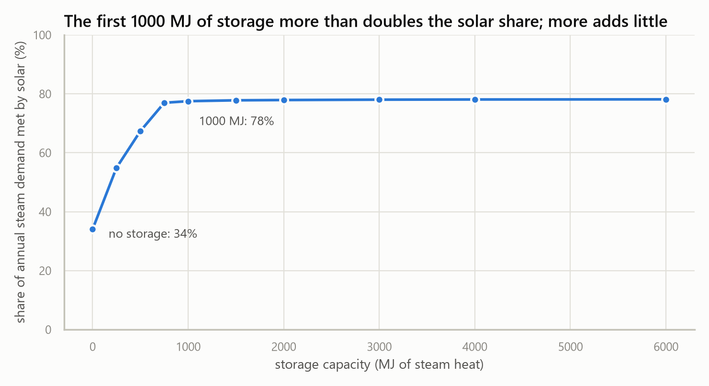
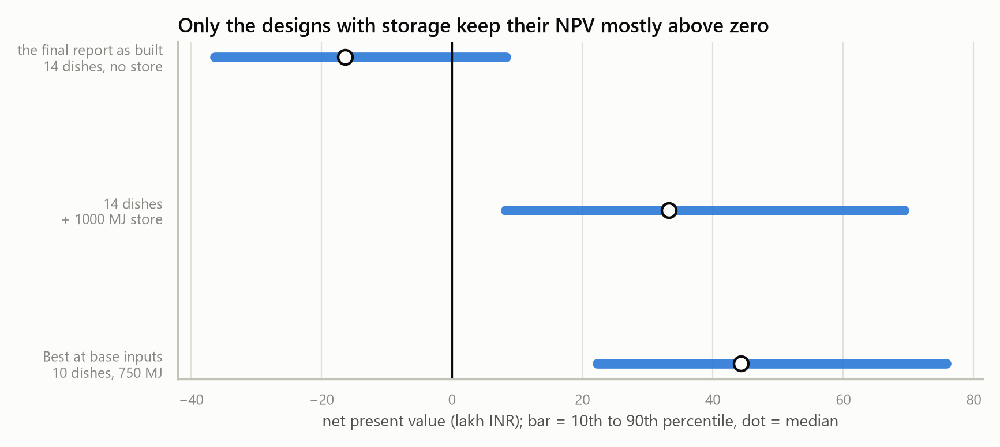

# Solar steam for hostel cooking: a second look at our EN 630 study

[](https://github.com/anandaayush09/EN630/actions/workflows/ci.yml)


In the EN 630 course (Utilisation of Solar Thermal Energy, IIT Bombay) my group asked whether Scheffler dishes could replace part of the LPG that cooks for about 1300 students in Hostel-17. We handed in a design: 14 dishes. Some time later I went back to check it. I rebuilt the study as code, compared every number with what we had submitted, ran the plant hour by hour, and put ranges on the economics. This page is the short version. The full story is in [`docs/report.md`](docs/report.md).

Author: Aayush M Anand (Group 05). The other authors are named in the reports.

## Phase 1: the group's project

The hostel mess uses 9 LPG cylinders of 14.2 kg a day, about 5900 MJ of heat. A Scheffler dish is a large curved mirror that turns to follow the sun and focuses it on a fixed receiver, where water turns to steam. We worked out the cooking load, picked weather data, modelled the sunlight and the dish, sized the field and finished with the economics.

Our final report concluded: **14 dishes**, an overall efficiency of 0.528, a payback of 4.3 years, an IRR of 20 % and about 41.5 t of CO2 avoided a year. It named one limitation: no thermal storage. The three reports are in [`reports/`](reports/):

| Report | File |
|--------|------|
| Proposal and system selection | [`proposal_and_system_selection.pdf`](reports/proposal_and_system_selection.pdf) |
| Performance and economics (with slides) | [`performance_and_economics_report.pdf`](reports/performance_and_economics_report.pdf), [`performance_and_economics_slides.pptx`](reports/performance_and_economics_slides.pptx) |
| Final report | [`final_report.pdf`](reports/final_report.pdf) ([`.docx`](reports/final_report.docx)) |

The first commit of this repository (`f8ab73f`) holds this work as it was submitted.

## The idea

Four things bothered me afterwards. The study could not be re-run: it lived in Excel, SAM and one script on an online compiler. The weather file was labelled Jodhpur, not Mumbai, and had no beam-sunlight column. The sizing was a daily total, which hides that mirrors work at midday while kitchens also cook in the evening. And the economics were single numbers with no sense of how wrong they could be. So I rebuilt it, with one rule: reproduce first, change second.

## Phase 2: the extension in six steps

| Step | The question | What I found | Details |
|------|--------------|--------------|---------|
| 2.1 Weather | Was the data even for the right place? | No. The file says Jodhpur. The replacement (PVGIS, Mumbai) had 50 impossible sunrise hours, now removed | [notebook 01](notebooks/01_data_eda.ipynb), [data card](docs/data_card.md) |
| 2.2 Reproduce | Can I rebuild what we reported? | 35 of 42 printed figures, yes. Seven do not follow from the report's own inputs, including a retrofit cost left out of the total | [notebook 02](notebooks/02_reproduce_final_report.ipynb) |
| 2.3 Physics | Is the radiation calculation right? | The original script ignored the tilt angle. Fixed, and checked against a reference library | [notebook 03](notebooks/03_corrected_physics.ipynb) |
| 2.4 Hour by hour | What happens over a real year? | 14 dishes without storage meet only about 34 % of the steam demand. A 1000 MJ store lifts it to 78 % | [notebook 04](notebooks/04_hourly_simulation.ipynb) |
| 2.5 Money | What does it cost, and how sure can I be? | Without a store it does not pay. With one it does. LPG price and its yearly rise matter most | [notebook 05](notebooks/05_economics_uncertainty.ipynb) |
| 2.6 Tools | Can anyone re-run it? | Command line, small app, Docker, 121 tests, automatic checks | [report, step 2.6](docs/report.md) |

<p align="center">
  
  
</p>

## Final results

- **Our numbers mostly hold.** 35 of 42 can be rebuilt exactly. The sizing of 14 dishes survives every reading of the inconsistent inputs.
- **The economics were too kind.** Adding the 30 % retrofit that the report lists but leaves out lowers the NPV from INR 35.9 to 16.8 lakh and lengthens the payback from 4.3 to 5.6 years.
- **No storage costs a lot.** Without it, 14 dishes displace about 454 LPG cylinders a year, not the 975 we claimed. The monsoon (June to August) limits solar to about a quarter of the load even with a store.
- **A smaller field with a store is better.** 10 dishes with a 750 MJ store gave the best NPV (about INR 29.9 lakh) and kept a positive NPV in all 2000 uncertainty draws.
- **What decides it:** the LPG price and how fast it rises (about 60 % of the variation in NPV). The weather year hardly matters (3 %).

## Conclusion

Our study was sound for a course, and the limitation we named turned out to be the most important result. Looked at again, it said more than it should have. Solar steam can cook a large part of the mess's food, but only with a store, and then the answer rests on two things I could not settle: what the store costs, and what LPG will cost over the next 15 years.

## Limitations

- The cost of the steam store is a placeholder (INR 1000 per MJ, range 500 to 2000); I have no quotation, and the positive case depends on it.
- Meal times and store losses are assumptions; without storage the meal times decide the result.
- The weather is modelled, not measured, and I could not check it against ground data.
- The dish is treated as an ideal sun-following mirror; the real shape-changing optics of a Scheffler dish are not modelled.

More, and what I would need to go further, is in [`LIMITATIONS_AND_FUTURE_SCOPE.md`](LIMITATIONS_AND_FUTURE_SCOPE.md).

## Run it

You need [uv](https://docs.astral.sh/uv/) and Python 3.11 or newer.

```bash
uv sync                           # installs the package and the tools
uv run en630 reproduce            # rebuilds the report's numbers and compares them
uv run en630 simulate --dishes 14 --storage 1000
uv run en630 sweep                # best number of dishes and store size
uv run --group app streamlit run app/streamlit_app.py   # what-if app
uv run pytest -q                  # 121 tests
uv run pytest --nbmake notebooks  # runs the five notebooks, about five minutes
```

With Docker instead:

```bash
docker build -t en630 .
docker run -p 8501:8501 en630                       # the app, at http://localhost:8501
docker run --rm en630 uv run en630 reproduce
docker run --rm en630 uv run en630 simulate --dishes 14 --storage 1000
```

The image (about 1.1 GB) holds the package, the data and the app. The tests and the notebooks are not in it; run those with `uv`, as above. The automatic checks build the image on every push.

`uv run en630 fetch-data` downloads the PVGIS data again (it needs a network); the files are already in `data/`.

## What is where

```
src/en630/     the package: weather, solar, irradiance, dish, load, fuel, economics,
               reproduce_final_report, simulate, uncertainty, plotting, cli
configs/       base.yaml (inputs of the final report, with page numbers),
               uncertainty.yaml (the ranges I varied, and why)
notebooks/     01 to 05, one per step, already run
tests/         121 tests
app/           the what-if app
data/          PVGIS typical year and 2005-2023 series, plus the course weather file
legacy/        the original radiation script, unchanged
reports/       our three submitted reports and figures
docs/          report.md (the full story) and data_card.md
```

## Credits and licence

Code: MIT licence ([`LICENSE`](LICENSE)). The reports remain the work of their authors. Weather data comes from PVGIS, European Commission Joint Research Centre; please cite the service if you reuse it. Built with pvlib, pandas, numpy, pandera, SALib, seaborn and matplotlib. How to cite: [`CITATION.cff`](CITATION.cff).
