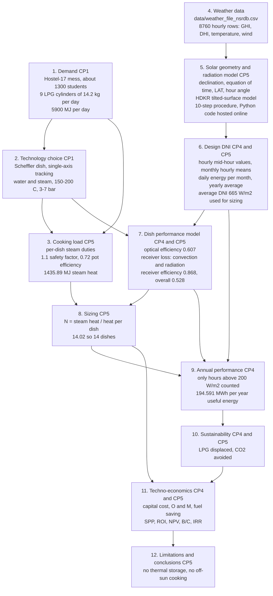

# Flow of execution — methodology from CP1 to CP5

This repository has **no executable code**. The "execution" is the analysis workflow the group followed, spread over five course projects (CP1–CP5) and carried out in Excel, SAM and a Python script hosted outside this folder (see the gap noted below). This file maps that workflow to the reports in [`../../reports/`](../../reports) and to the data in [`../../data/`](../../data).

Every figure below is quoted from the group's own reports (file named in brackets). Nothing was recomputed by the author of this file except where explicitly marked **(checked)**. Where the reports disagree with each other, both values are shown.

Report keys: **CP1** = `reports/CP1_G05.pdf`, **CP4** = `reports/CP4_G05.pdf` (+ `CP4_G05_presentation.pptx`), **CP5** = `reports/CP5_final_report.docx`.

## 1. Flowchart

## 2. Step table

| # | Step | Where it is documented | Inputs | Output | Tool (as stated in reports) |
|---|------|-----------------------|--------|--------|-----------------------------|
| 1 | Demand | CP1 §2; CP4 §2.2; CP5 | Mess data: about 1300 students, 9 cylinders of 14.2 kg per day, LPG calorific value 46.1 MJ/kg | 654.6 MJ per cylinder, **5900 MJ per day** | Hand calculation |
| 2 | Technology choice | CP1 §3; CP4 §2.1; CP5 | Scheffler dish description | Water as heat-transfer medium, 150–200 °C, 3–7 bar | Literature (references in the reports) |
| 3 | Cooking load | CP5 "Load Calculations" | Food list (rice, milk, vegetables/curry, dal, hot water), specific heats, moisture content | Per-dish loads (e.g. milk heating 41.84 MJ per 150 L batch; 25 L water 7.85 MJ); design load 939.86 MJ × 1.1 = 1033.846 MJ; ÷ 0.72 cooking-pot efficiency = **1435.89 MJ** steam heat. CP4 Table 1 lists 1436 MJ | Hand calculation / Excel |
| 4 | Weather data | `data/weather_file_nsrdb.csv` | NSRDB-format file: 8760 hourly rows with Hour, GHI, DHI, Temperature, Wind Speed | Hourly GHI and DHI | NSRDB export (see warning in §4) |
| 5 | Radiation model | CP5 "Radiation model" (equations 1–16, steps 1–10) | Day number n, longitude, standard-time longitude, latitude (19.15° N, 72.95° E stated in CP5), hourly Ig and Ibn | Declination, equation of time, LAT, hour angle, zenith/incidence angles, rb, rd, rr, tilted-surface radiation (HDKR) | Python script (link in CP5 to an online IDE; **not stored in this folder**) |
| 6 | Design DNI | CP4 §2.3; CP5 "Determining Solar Radiation value for Sizing the system" | Hourly values at mid-hour | Monthly hourly means → daily energy per month → yearly average; **average DNI 665 W/m²** used in efficiency and sizing; CP4: counting only hours above 200 W/m² gives **1.6488 MWh/m²** | Excel; SAM used to evaluate solar potential |
| 7 | Dish performance | CP4 §3.1; CP5 "Performance Analysis Model" | Reflectivity 0.9, receiver absorptivity 0.7, cos θ = 0.943822 (17 May, 12:30), receiver aperture 0.1294 m², reflector aperture 11.65 m², h = 25 W/m²K, Tr = 473 K, Ta = 301 K | Concentration ratio 90.3; optical efficiency **0.607821**; receiver loss 618.29 W against 4708.9 W absorbed; receiver efficiency **0.8687**; overall **0.528** | Hand calculation |
| 8 | Sizing | CP5 | 1435.89 MJ; 665 W/m² × 11.65 m² × 3600 s × 7 × 0.8626 × 0.6078 per dish | 14.02 → **14 dishes** | Hand calculation |
| 9 | Annual performance | CP4 §3.2 | 1.6488 MWh/m² × 0.607 × 0.868 × 16 × 14 | **194.591 MWh per year** | Hand calculation |
| 10 | Sustainability | CP4 §4.1; CP5 | 1436 MJ ÷ 655 MJ per cylinder = 2.2 cylinders; CO₂ per cylinder 42.6 kg | CP4: 3.67 cylinders/day, 52.06 kg LPG/day, 57.06 t CO₂/year. CP5: 41.5 t CO₂/year (42.6 kg × 975) | Hand calculation |
| 11 | Techno-economics | CP4 §4.2; CP5 "Cost Analysis" | See §3 below | See §3 below | Hand calculation / Excel |
| 12 | Limitations | CP5 | — | No thermal storage system, so no cooking at night or in low-sun periods | — |

## 3. CP4 versus CP5 economics (as stated in each report)

| Quantity | CP4 | CP5 |
|----------|-----|-----|
| Dish cost basis | ₹18,000 per m² → ₹288,000 for a 16 m² dish | ₹25,000 per m² → ₹400,000 for a 16 m² dish |
| Retrofit allowance | 30 % of capital cost; ₹374,400 per dish including it | 30 % of capital cost, ₹120,000 per dish |
| Total system (14 dishes) | ₹5,241,600 | "56 lakh" (₹5,600,000) |
| LPG price per cylinder | ₹950 | ₹1,345 |
| Annual fuel saving | ₹1,272,572.5 | ₹1,311,631.57 |
| Simple payback | 4.11 years | 4.269 years |
| ROI | 24.33 % | 23.42 % |
| O&M (2 % of capital) | ₹104,832 per year | ₹112,000 per year |
| Salvage value (5 %) | ₹262,080 | ₹280,000 |
| NPV | ₹3,703,066.09 | ₹3,591,518 |
| Benefit/cost ratio | 1.613 | 1.556 |
| IRR | 21.07 % | 20.116 % |
| CO₂ avoided | 57.06 t per year | 41.5 t per year |
| Common assumptions | Dish life 15 years, discount rate 10 % | Dish life 15 years, discount rate 10 % |

## 4. Known gaps and inconsistencies in the source material

These are observations from reading the reports, recorded so the next person can resolve them. None has been corrected in the source files.

1. **Weather-file location.** The file header reads *City: Jodhpur, Rajasthan, latitude 26.35, longitude 73.05, NSRDB location ID 20013*, while CP4 and CP5 describe the data as specific to IIT Bombay Hostel-17 (19.15° N, 72.95° E). It is unknown which location the group's DNI numbers (665 W/m²) were actually computed from. The columns are Hour, GHI, DHI, Temperature and Wind Speed; there is no DNI column although the header declares DNI units.
2. **Analysis code is outside this folder.** CP5 says a Python script performed the radiation steps and links to an online IDE; the script is not in the folder.
3. **Own-group CP2/CP3 reports are missing.** The folder holds only a screenshot for CP2 (`reports/figures/cp2_screenshot.png`) and another group's CP2/CP4 (moved to `_review/`). Their role in the flow (steps 5–8) is inferred from the wording of CP4 and CP5.
4. **Receiver efficiency used in sizing differs** from the one derived: 0.8626 in the sizing product, 0.8687 in the efficiency calculation. The factor 7 in the sizing product is not labelled in the report.
5. **Reflectivity.** The text lists reflectivity 0.9, but the optical-efficiency product is written with 0.92 (0.943822 × 0.92 × 0.7 = 0.607821, **checked**).
6. **Dish area.** Sizing uses a reflector aperture of 11.65 m², while the annual-energy and cost calculations use 16 m² per dish.
7. **CP5 NPV line.** The printed formula line still contains the CP4 component values (9679287.61 + 62739.86 − 797360.5 − 5241600 = 3,703,066.97, **checked**), while the quoted result ₹3,591,518 corresponds to the CP5 components (9976370 + 67029.77 − 851881 − 5600000 = 3,591,518.77, **checked**).
8. **CP5 total system cost.** "56 lakh" equals 14 × ₹400,000 (**checked**), i.e. it does not appear to include the ₹120,000-per-dish retrofit stated just above it. CP4's total did include it.
9. **Rice-load wording.** CP5 gives "20 litres of water and 28 kg of rice" in one sentence and "Mf = 20 kg, Mw = 28 litre" in the next.
10. **Cylinders saved per year.** CP4 implies 3.67 per day (about 1340 per year); CP5's CO₂ figure implies 975 per year. The report does not explain the change of method.
