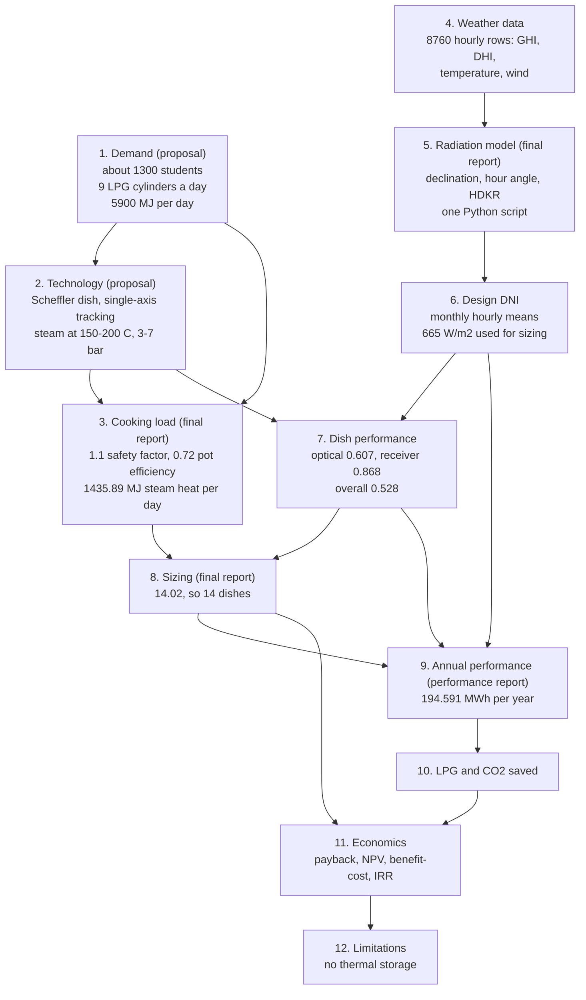
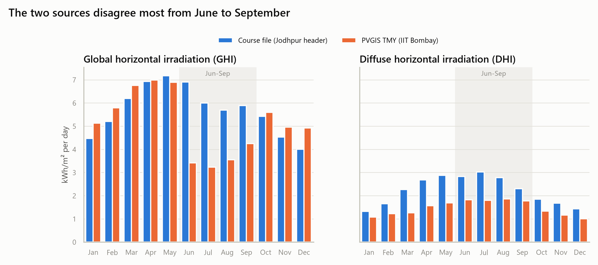
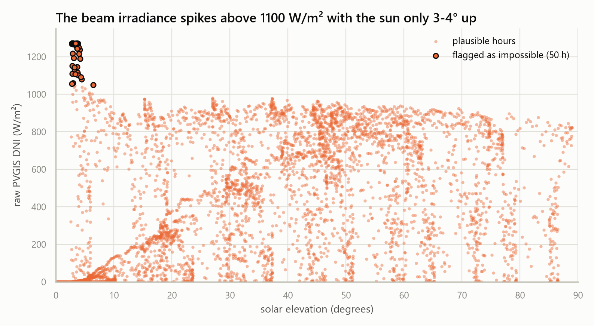
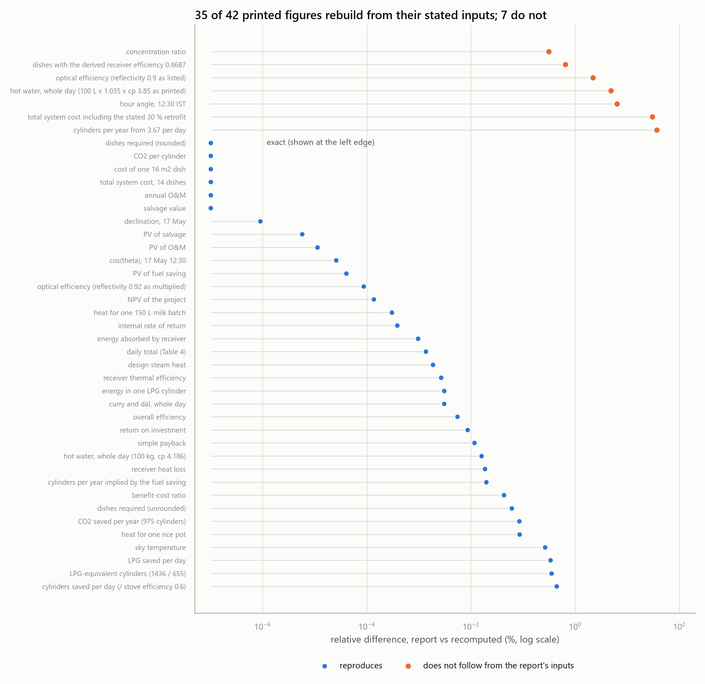
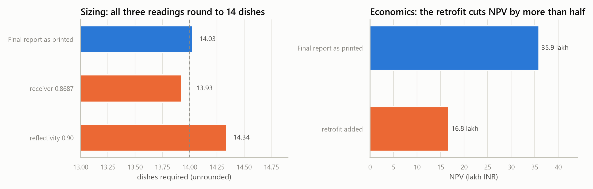
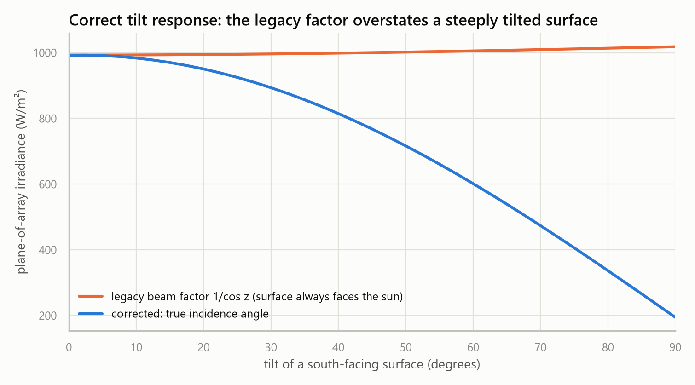
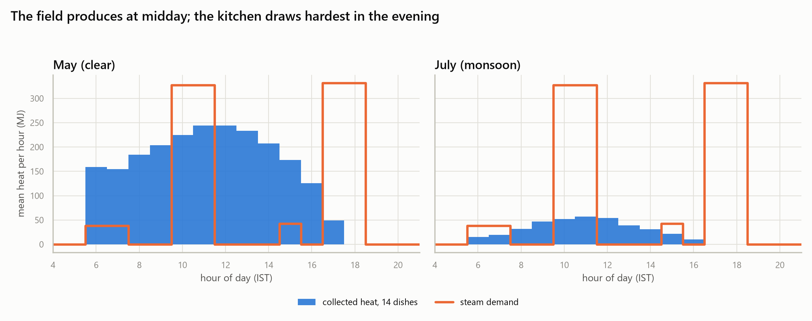
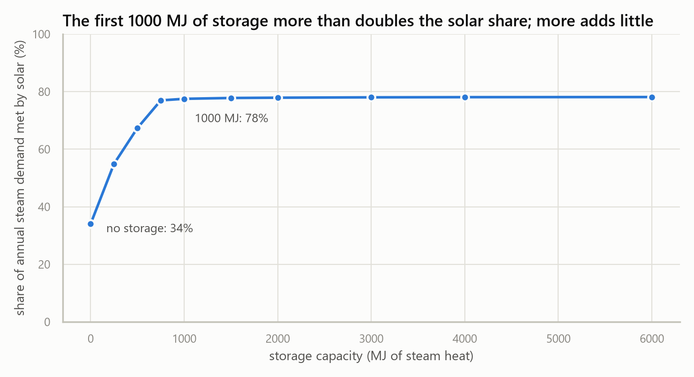
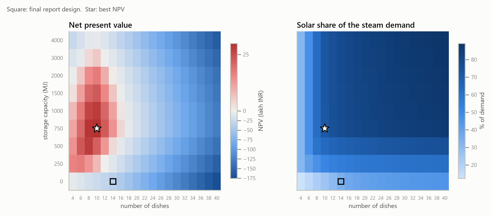
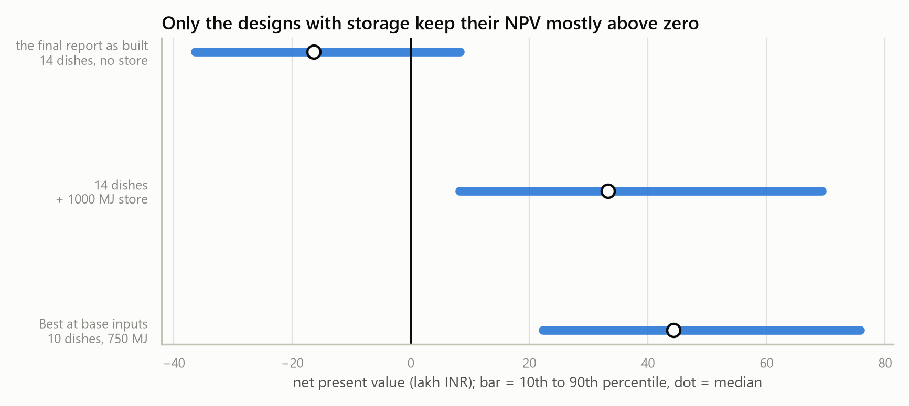

# Going back to our solar cooking study: what I did and what I found

This is the long version of the story in the [README](../README.md). Each step of the extension has the same four parts: why I did it, what I did, what I found, and what I take from it. Every number comes from the notebooks in `notebooks/` or from the tests; nothing here was typed in by hand from memory.

A note on names. The course split the work into five submissions. The three that are in this repository are named by their content: the proposal (`reports/proposal_and_system_selection.pdf`), the performance and economics report (`reports/performance_and_economics_report.pdf`, with its slides) and the final report (`reports/final_report.pdf`). The PDFs themselves still show the course labels on their pages. Below I call the middle one "the performance report".

## 1. Where this started: the group's project

My group (Group 05) took a question from the course on solar thermal energy. The mess of Hostel-17 at IIT Bombay cooks for about 1300 students and uses 9 LPG cylinders of 14.2 kg every day, roughly 5900 MJ of heat. Could Scheffler dishes cover part of that? A Scheffler dish is a large curved mirror that turns to follow the sun and focuses it on a receiver that stays in one place. Water in the receiver turns to steam, and the steam is piped to the kitchen.

We worked through it in the order the course asked for. We worked out the demand, chose the technology, added up the cooking loads, picked the weather data, modelled the sunlight, found a design value for the direct beam of sunlight (DNI, the part a mirror can focus), modelled the dish, sized the field, estimated the annual energy, counted the LPG and CO2 saved, and finished with the economics.

What the final report says: 14 dishes of 11.65 m2 aperture each supply 1435.89 MJ of steam a day at a design DNI of 665 W/m2. The optical efficiency is 0.607, the receiver efficiency 0.868 and the overall efficiency 0.528. The simple payback is 4.269 years, the benefit-cost ratio 1.556, the IRR 20.116 % and the NPV INR 3,591,518. About 41.5 t of CO2 is avoided each year. We also wrote down one limitation ourselves: the system has no thermal storage.

The performance report, written earlier, used different cost and fuel-price assumptions, so the two reports do not give the same economics:

| Quantity | Performance report | Final report |
|----------|--------------------|--------------|
| Dish cost basis | INR 18,000 per m2 (INR 288,000 for a 16 m2 dish) | INR 25,000 per m2 (INR 400,000 for a 16 m2 dish) |
| Retrofit allowance | 30 % of capital cost, included in the total | 30 % of capital cost (INR 120,000 per dish), listed but not added to the total |
| Total for 14 dishes | INR 5,241,600 | "56 lakh" (INR 5,600,000) |
| LPG price per cylinder | INR 950 | INR 1,345 |
| Annual fuel saving | INR 1,272,572 | INR 1,311,632 |
| Simple payback | 4.11 years | 4.269 years |
| NPV | INR 3,703,066 | INR 3,591,518 |
| Benefit-cost ratio | 1.613 | 1.556 |
| IRR | 21.07 % | 20.116 % |
| CO2 avoided | 57.06 t per year | 41.5 t per year |

## 2. Why I went back to it

Four things bothered me once the course was over.

1. **I could not re-run it.** The work was done by hand, in Excel, in SAM and with one Python script that lives on an online compiler. Nobody, including me, could check a number without redoing it.
2. **The weather file looked wrong.** Its header names Jodhpur, not Mumbai, and it has no column for DNI, even though the key number of the whole design is a DNI.
3. **The sizing was a daily total.** Mirrors make heat at midday, but a mess also cooks in the evening. We had written "no storage" as a limitation without ever measuring what it costs.
4. **The money was a single number.** Nobody had asked how wrong it could be.

So the idea was simple: rebuild the study as code, check every number against what we submitted, fix what is wrong, run the plant hour by hour, and put ranges on the economics. I set one rule for myself: reproduce first, change second. I did it in six steps. Steps 2.1 to 2.5 each have a notebook that you can open on GitHub.

## 3. The extension, step by step

### Step 2.1: Was the weather data even for the right place?

**Why.** Everything downstream depends on the sunlight data, so I started there.

**What I did.** I loaded the course file and downloaded a typical year for IIT Bombay (19.15 N, 72.95 E, the coordinates in our reports) from PVGIS, a free European service. I wrote checks that a weather table has to pass: 8760 hourly rows, no negative values, diffuse light never larger than global light, no sunshine at night. Then I compared the two sources month by month (notebook 01).

**What I found.**
- The course file passes every check for Jodhpur and for Mumbai alike, because the two cities have almost the same longitude. So the checks catch broken data, not a wrong place. The comparison is what shows the difference: annual global radiation is 2083 kWh/m2 in the course file and 1871 kWh/m2 in the PVGIS series, and annual diffuse radiation is 814 against 536 kWh/m2. They differ most from June to September.
- My first night-time check complained about 58 PVGIS hours. They were real twilight, 1 to 2 W/m2 with the sun a few degrees below the horizon, so I moved the limit to civil twilight and wrote down how the time stamps are read.
- Something I did not expect: a dark band at 07:00 in my heatmap of beam sunlight. Plotting DNI against the height of the sun showed 50 sunrise hours with DNI between 1050 and 1271 W/m2 while the sun was only 3 to 6.5 degrees up. That is physically impossible; it is what you get from dividing by a very small number. I set those hours to zero, which removes 2.9 % of the annual beam energy (2.113 to 2.052 MWh/m2). A further 66 low-sun hours above 450 W/m2 pass my bound, about 3 % of the annual beam energy; I could not tell whether they are real.
- Our design DNI of 665 W/m2 is higher than the mean DNI I get from either source (560 W/m2 from the course file, 634 W/m2 from cleaned PVGIS, for hours above 200 W/m2). The performance report's 1.6488 MWh/m2 is lower than the annual energy from either source. The two numbers do not seem to come from one consistent calculation.
- Real years differ. Over 2005 to 2023 the annual beam energy ranges from 1876 to 2106 kWh/m2, about plus or minus 5 %.

**What I take from it.** The weather source is itself a major assumption of the design, and the data I ended up with is modelled, not measured. I have no ground measurements to check it against. The data card ([`data_card.md`](data_card.md)) lists sources, conventions and limits.

### Step 2.2: Can I rebuild what the group reported?

**Why.** If I cannot get the printed numbers out of the printed inputs, nothing I build on top is trustworthy.

**What I did.** I put every input of the final report in one file, `configs/base.yaml`, each with the page it came from. I wrote the formulas as small functions and compared 42 printed figures with what the functions return (notebook 02). A figure counts as reproduced if it agrees to the precision the report prints. I did not tune any input to make a figure match. Four rows needed a looser tolerance (1e-4 instead of 1e-5) because the report rounds an intermediate value, for example a cylinder's energy as 654.6 MJ instead of 654.62 MJ; each of those rows says so.

**What I found.** Thirty-five of the 42 figures reproduce, including the efficiencies (0.6078, 0.8687, 0.528), the daily load of 939.86 MJ, 14 dishes, the 4.269-year payback, the NPV, the benefit-cost ratio and the IRR. Seven do not follow from the report's own inputs:

| Figure | Printed | Recomputed |
|--------|---------|------------|
| Hour angle at 12:30 on 17 May | -1.1446 degrees | -1.0723 degrees (no effect on the result) |
| Concentration ratio | 90.3091 | 90.0309 |
| Optical efficiency with the reflectivity listed in the text (0.90) | 0.6078 | 0.5946 |
| Hot-water load from the inputs printed beside it | 31.40 MJ | 29.89 MJ |
| Dishes with the receiver efficiency derived in the report (0.8687, not the 0.8626 used in sizing) | 14.02 | 13.93 |
| Cylinders saved per year, from 3.67 per day | 975 | about 1340 |
| Total cost including the listed 30 % retrofit | INR 56 lakh | INR 72.8 lakh |

The sizing survives all of this: every reading gives 14 dishes after rounding (13.93 to 14.34 before). The economics do not. Adding the 30 % retrofit that the report lists but leaves out lowers the NPV from INR 35.9 lakh to 16.8 lakh, lengthens the payback from 4.3 to 5.6 years and lowers the IRR from 20.1 % to 13.8 %. The project still pays back within the 15-year life of the dishes.

**What I take from it.** The group's work holds up much better than I feared: most of it can be rebuilt exactly. The place where it is weakest is the cost, and that is easy to miss when each number looks fine on its own. The full list of inconsistencies is in appendix A.

### Step 2.3: Is the radiation calculation right?

**Why.** The Python script we used had to be right for any of the dish numbers to mean something, and I wanted solar geometry I could test.

**What I did.** I kept the original script untouched in `legacy/` and wrote new array-based functions for solar geometry, for sunlight on a tilted surface (isotropic and HDKR models), for tracking mirrors, and for splitting global radiation into beam and diffuse light. I tested the geometry against pvlib, a well-checked solar library, and compared the new model with the old script by actually running the old script (notebook 03).

**What I found.**
- The old script's beam factor ignores the tilt angle. For a surface tilted 60 degrees at midday it gives 1006 W/m2 where the corrected model gives 602 W/m2. It also crashed on a wrong menu answer and on night-time input, and ignored the standard longitude that was typed in (appendix B). All of these are now fixed and tested.
- The solar geometry agrees with pvlib to within 0.25 degrees over a year using Spencer's formula for the sun's declination. The simpler formula from our course reaches 1.16 degrees, which misses the 0.5-degree target I had set myself, so the new code uses Spencer's formula and keeps the course one as an option to reproduce the report.
- The new fixed-surface models match pvlib's to within 0.21 % in annual totals.
- At the latitude tilt a single-axis polar tracker collects 1970 kWh/m2 of beam sunlight a year against 1458 for a fixed south-facing surface and 2048 for a tracker that follows the sun on two axes.
- When only global radiation is available, estimating the beam is poor. Two standard models, Erbs and DIRINT, recover 1637 and 1507 kWh/m2 of the 2052 in the PVGIS series (they run low by 104 and 138 W/m2 on average). On the course file, three ways of deriving DNI give 1873, 2048 and 2077 kWh/m2, a spread of about 10 %.

**What I take from it.** The beam term is exactly right for a surface that always faces the sun and wrong for any fixed surface, so the script was only safe for the tracking case. The dish itself is still an idealised polar tracker here: I did not model the changing mirror shape of a real Scheffler dish.

### Step 2.4: What happens hour by hour?

**Why.** The final report sized the field on a daily total and said "no storage". It could not say when the heat is available and when the kitchen needs it.

**What I did.** I built an 8760-hour simulation of the year. Each hour the dishes make heat, the kitchen uses what it can, any surplus goes into a steam store (which can have size zero), and LPG covers the rest. The report gives how much energy each meal needs but not when it is cooked, so I wrote down a meal timetable as an explicit assumption (notebook 04). I made sure the energy adds up every hour and tested the limiting cases: no dishes means all LPG, no store means the store is never used.

**What I found.**
- 14 dishes without storage meet 34 % of the year's steam demand. The mirrors peak at midday, while 46 % of the day's steam is drawn after 17:00.
- They displace about 454 LPG cylinders and 19 t of CO2 a year, against the 975 cylinders and 41.5 t in the final report.
- A steam store changes this a lot:

| Store size (MJ) | 0 | 250 | 500 | 1000 | 6000 |
|-----------------|---|-----|-----|------|------|
| Share of steam demand met by solar | 34 % | 55 % | 67 % | 78 % | 78 % |

- With a 1000 MJ store, solar meets 96 to 100 % of the load from October to May, but only 25 to 28 % from June to August (57 % in September). The monsoon is the limit, not the size of the store.
- The meal timetable matters when there is no store: if all cooking were done between 10:00 and 15:00, the no-store share would be 56 %, not 34 %.
- The simulated annual heat from 14 dishes is 173 MWh, against 194.6 MWh in the performance report. That report used a different mirror area, weather source and efficiency basis, and I did not manage to reconcile the two.

**What I take from it.** The limitation we wrote down at the end of the final report was correct, and it was bigger than we said: without storage the plant does less than half of what we claimed in LPG savings.

### Step 2.5: What does it cost, and how sure can I be?

**Why.** One NPV hides how much it can move.

**What I did.** I added what the final report left out (the retrofit) and what the new design needs (a store), and defined a levelised cost of heat: what one MJ of solar heat costs over the life of the plant, to compare with what one MJ costs from LPG. I wrote down eleven uncertain inputs with a range and a reason for each in `configs/uncertainty.yaml`: the weather year (19 real years), mirror performance, dinner time, store efficiency and losses, LPG price and its yearly rise, dish cost, retrofit share, store cost and the discount rate. I then drew all eleven together 2000 times (Monte Carlo), measured which inputs drive the answer (Sobol indices) and swept the number of dishes against the store size (notebook 05).

**What I found.** The base case, with a constant LPG price and the store costed at a placeholder of INR 1000 per MJ:

| Design | Capital (lakh INR) | Solar share | NPV (lakh INR) | Payback (years) | Solar heat against LPG heat (INR per MJ) |
|--------|-------------------:|------------:|---------------:|----------------:|------------------------------------------|
| 14 dishes, no store | 72.8 | 34 % | -36.5 | 11.9 | 6.11 against 3.42 |
| 14 dishes, 1000 MJ store | 82.8 | 78 % | +11.4 | 5.95 | 3.05 against 3.42 |
| 10 dishes, 750 MJ store (best NPV in the sweep) | 59.5 | 72 % | +29.9 | 4.6 | 2.38 against 3.42 |

- Over the 2000 draws the NPV is negative in 81 % of cases for 14 dishes without a store, in 4 % with a 1000 MJ store and in none of the draws for 10 dishes with a 750 MJ store.
- The medians in the Monte Carlo are higher than the base case (33 lakh against 11 lakh for 14 dishes with a store) because the drawn LPG price rise averages about 3 % a year, while the base case, like the final report, assumes none.
- What drives the NPV: the LPG price rise (share of variance 0.31), the LPG price (0.30), the dish cost (0.13) and the discount rate (0.13). The weather year accounts for 0.03, the store cost for 0.02 and everything else for less. With 64 base samples the confidence intervals are wide (plus or minus 0.1 to 0.18), so only the two leading inputs are clearly ahead of the rest.

**What I take from it.** Without a store, the design does not pay. With a store it does, and a smaller field with a store beats the 14 dishes we proposed. But I would not quote the store result without its warning: the store cost is a placeholder based on a rough estimate (about 5 m3 of pressurised water per GJ), because I have no quotation. The best design is also only best for one set of inputs; I did not search for a design that is robust across all of them.

### Step 2.6: Making it easy to re-run

**Why.** A result that nobody can run is just a claim.

**What I did.** The code lives in a package (`src/en630`) with a command line (`en630 reproduce`, `simulate`, `sweep`, `fetch-data`) and a small what-if app in Streamlit where you can move the number of dishes, the store size and the prices and watch the answer change. The environment is pinned in `uv.lock`, a Dockerfile builds a small image with the package, the data and the app (I checked that the command line and the app give the same numbers inside it as outside), and GitHub Actions runs the checks on every push. There are 121 tests (99 % of lines covered): a regression test for every reproduced figure, tests of the energy balance, and property tests that try random designs.

**What I take from it.** The tests mattered more than I expected. Several of the findings above came from a test or a figure that did not look right, not from the analysis I had planned.

## 4. Final results

| Question | Answer |
|----------|--------|
| Can the final report's numbers be rebuilt from its own inputs? | 35 of 42 yes; 7 do not follow, including a retrofit cost left out of the total |
| Was the weather file right? | No: it is labelled Jodhpur and has no beam data. The PVGIS series for IIT Bombay needed 50 impossible sunrise hours removed |
| Was the original script right? | Its beam term ignored tilt; fixed and tested |
| What share of the load does the proposed design (14 dishes, no store) meet? | About 34 % |
| Do the claimed LPG savings hold? | Not without storage: about 454 cylinders a year against 975 |
| What does a 1000 MJ store change? | The solar share rises to 78 %; the monsoon then limits it |
| Is it worth it? | Not without a store; with one, payback is about 6 years (on a placeholder store cost) |
| What matters most? | The LPG price and how fast it rises; the weather year matters little |

## 5. Conclusion

Our study was a sound piece of work for a course. Most of its numbers can be rebuilt exactly from its own inputs, and the limitation we named at the end turned out to be the most important result. Looked at again, though, it said more than it should have: it left out the retrofit cost, it counted LPG savings on a basis that does not match its own sizing, and with no storage the 14 dishes would meet only about a third of the load.

Solar steam can cook a large part of the mess's food, but only with a store, and then the answer depends on two things I could not settle: what the store costs and what LPG will cost over the next 15 years. I take away that a design that looks fine on a daily balance can look very different hour by hour, and that a single number for the economics hides how uncertain it is.

What I could not do, and what I would need to do it, is in [`LIMITATIONS_AND_FUTURE_SCOPE.md`](../LIMITATIONS_AND_FUTURE_SCOPE.md).

## Appendix A: inconsistencies I found in our reports

None of these was corrected in the submitted files.

1. **Weather-file location.** The header says Jodhpur (26.35 N, 73.05 E, NSRDB location 20013), while the performance and final reports describe the data as specific to Hostel-17 (19.15 N, 72.95 E). It is not known which location the 665 W/m2 came from. The file has no DNI column although its header declares DNI units.
2. **Script provenance.** The final report links to an online compiler for its Python script. I compared the copy in `legacy/` with the online one: apart from trailing spaces they are identical (55 lines, same checksum).
3. **Missing submissions.** The two submissions between the proposal and the performance report are not in the repository, so their role is inferred from how the later reports refer to them. The only trace is the group's Excel sheet of monthly hourly DNI (`reports/figures/hourly_dni_spreadsheet.png`).
4. **Receiver efficiency.** 0.8626 in the sizing product, 0.8687 in the efficiency calculation. The factor 7 in the sizing product (hours of design operation) is not labelled.
5. **Reflectivity.** The text lists 0.9, but the optical-efficiency product uses 0.92 (0.943822 x 0.92 x 0.7 = 0.607821).
6. **Dish area.** Sizing uses 11.65 m2 per dish; the annual-energy and cost calculations use 16 m2.
7. **NPV line.** The printed formula still contains the performance report's component values (sum 3,703,066.97), while the quoted result of INR 3,591,518 matches the final report's components (3,591,518.77).
8. **Total system cost.** "56 lakh" equals 14 x INR 400,000: the INR 120,000 per dish retrofit stated just above it is not in the total. The performance report's total did include it.
9. **Rice load wording.** "20 litres of water and 28 kg of rice" in one sentence, "Mf = 20 kg, Mw = 28 litre" in the next.
10. **Cylinders saved per year.** The performance report implies 3.67 a day (about 1340 a year); the final report's CO2 figure implies 975. The change of method is not explained.
11. **Concentration ratio.** 11.65 / 0.1294 is 90.031; 90.3091 is printed (two digits swapped). It is not used further.
12. **Sky-temperature formula.** The coefficient is printed as 0.00553 and called Swinbank's equation. Only 0.0553 with a +10 K offset gives the printed 298 K; the textbook relation is 0.0552 Ta^1.5 with no offset.
13. **Hot-water load.** The inputs printed beside 31.40 MJ (100 L, density 1.035, cp 3.85) give 29.89 MJ. 31.40 MJ comes from 100 kg of water with cp 4.186.
14. **Hour angle.** -1.1446 degrees is printed for 12:30 on 17 May; the report's own equations give -1.0723 degrees. The effect on the result is below 1e-5.
15. **Design-day latitude.** The site latitude is 19.15 N but the incidence angle uses 19.076 N. With the tilt equal to the latitude and a south-facing surface, the result does not depend on which one is used.
16. **Daily load.** The load table has a 20 MJ milk line for snacks that is not derived anywhere in the text; the 939.86 MJ total depends on it.

## Appendix B: defects of the original radiation script

The script is in `legacy/original_radiation_script.py`, exactly as written. The new package fixes each item and has a test for it (`tests/test_physics.py`).

| ID | What goes wrong | How it was found | How it is fixed |
|----|-----------------|------------------|-----------------|
| B1 | The beam term is the same at every tilt (it uses 1 / cos of the zenith angle, which is the beam on a surface that always faces the sun) | Ran it: tilt 0 and 60 degrees differ by 15 W/m2, all of it diffuse and ground-reflected light | The true incidence angle is used for a fixed surface; the old factor survives as the two-axis tracker, where it is right |
| B2 | A hemisphere answer other than E or W prints "Error" and then crashes | Ran it (`NameError`) | A signed longitude replaces the letter |
| B3 | A model number other than 1 or 2 prints a message and then crashes | Reading | Models are named; a wrong name raises an error that lists the valid ones |
| B4 | The standard longitude that is typed in is ignored (82.5 is hard-coded) | Reading | It is a parameter and is used |
| B5 | The anisotropic model divides by zero when global radiation is zero (night) | Ran it (`ZeroDivisionError`) | Hours with the sun lower than about 3 degrees return exact zeros |
| B6 | `Io` is computed but never used, and its cosine takes radians where degrees are needed | Reading | Corrected and used in a tested function |
| B7 | The west-longitude branch of the time correction is unverified | Reading | One formula for every longitude, so the case no longer exists |

## Appendix C: how the work was checked

- 121 automated tests pass, with 99 % of the package's lines covered. They include a regression test for each reproduced figure, an energy-balance test for every simulated hour, and tests that run the original script and compare it with the new code.
- `ruff` (style) reports nothing and `pyright` (types) reports no errors. It does report 58 warnings, which come from pandas and pvlib having only partial type information.
- The five notebooks execute from top to bottom, and GitHub Actions runs the lint, the type check, the tests and the notebooks on every push.
- A second PVGIS download is identical to the committed file, and a fresh clone installs and passes the tests.
- The Docker image builds and runs: inside it `en630 reproduce` gives 35 of 42, and `en630 simulate` and the what-if app show the same numbers as the notebooks. The 121 tests also pass inside it once pytest and the tests are added. It runs as a non-root account and holds none of the repository's other files.
- Not checked: pre-commit hooks (written, never run), and anything against measured data, because I had none.
